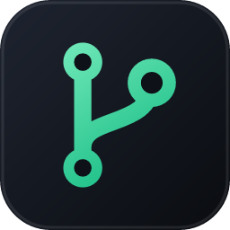

<div align="center">



# Akulav Tracker

**Every GitHub repository you own, at a glance, and which ones need you. Made by Akulav.**

No spyware. No telemetry. It only talks to GitHub. One file per system that installs and updates itself.

[](https://github.com/Akulav/github-tracker/releases/latest)
[](https://github.com/Akulav/github-tracker/releases)
[](https://github.com/Akulav/github-tracker/actions/workflows/build.yml)


### [⬇ Download the latest release](https://github.com/Akulav/github-tracker/releases/latest)

</div>

---

## ⬇️ Download

One file per system. The same file installs the app the first time and updates it later.

| Platform | File | Notes |
| :-- | :-- | :-- |
| 🪟 **Windows 10 / 11** (x64) | [`AkulavTracker-setup.exe`](https://github.com/Akulav/github-tracker/releases/latest/download/AkulavTracker-setup.exe) | Asks where to install. No admin rights needed. |
| 🐧 **Linux** (x64) | [`AkulavTracker-linux-x64`](https://github.com/Akulav/github-tracker/releases/latest/download/AkulavTracker-linux-x64) | glibc 2.28+, OpenGL, X11 or Wayland |
| 🍎 **macOS** (Apple Silicon) | [`AkulavTracker-macos-arm64`](https://github.com/Akulav/github-tracker/releases/latest/download/AkulavTracker-macos-arm64) | macOS 12+ |

Every release also ships `SHA256SUMS.txt` so you can verify your download.

## ✨ Features

<table>
<tr>
<td width="50%" valign="top">

### 📊 Overview
- Repositories, total commits, lines of code, stars and your commit-day streak.
- A year of weekly commit activity and a **contribution calendar** across all repositories.
- Language breakdown over everything you own.

</td>
<td width="50%" valign="top">

### 🗂️ Repositories
- Search, filter (mine / private / public / forks / archived / needs attention) and sort by last
  commit, name, commits, lines or stars.
- Every row has a 6-month sparkline and a color-coded "last commit" pill.

</td>
</tr>
<tr>
<td width="50%" valign="top">

### 🩺 Maintenance radar
- Every repository plotted by time since its last commit, from today to years.
- Grouped into **Active · Recent · Cooling · Stale · Dormant**, plus a ranked *needs attention* list.

</td>
<td width="50%" valign="top">

### 🔎 Repository detail
- **Code evolution**: total lines after every commit (newest 1,000), with lines added and removed.
- Contribution heatmap, weekly commits, code frequency, languages.
- The commit list with per-commit `+`/`−` and running totals, and shortcuts to GitHub.

</td>
</tr>
<tr>
<td width="50%" valign="top">

### ⚡ Fast & light
- A single native binary written in Rust. No .NET, no Electron.
- The last sync is cached, so the app opens instantly and only refetches repositories that changed
  (or whose statistics are more than a day old).

</td>
<td width="50%" valign="top">

### 🔄 Always up to date
- **You choose the install folder** once; the app and all its data live there.
- **One-click updates** from GitHub, verified with SHA-256, into the same folder.
- Checks at start and every 3 hours (can be turned off in Settings).

</td>
</tr>
</table>

## 🚀 Getting started

### Windows
1. Download **`AkulavTracker-setup.exe`** and run it.
2. Pick the install folder (default `%LOCALAPPDATA%\Programs\AkulavTracker`, any folder you can write to works,
   e.g. `D:\Apps\AkulavTracker`). It adds Start-menu and (optional) Desktop shortcuts and an entry in
   *Settings → Apps*.
3. Updates install into the same folder without asking: in-app with one click, or by running a newer setup.

Uninstall from *Settings → Apps* or from Settings in the app. The uninstaller asks whether to keep the cache,
settings and saved sign-in.

### Linux
```bash
chmod +x AkulavTracker-linux-x64
./AkulavTracker-linux-x64
```
It asks for an install folder (default `~/.local/share/AkulavTracker`), copies itself there and adds an app-menu
entry with icon, a Desktop shortcut and an `akulav-tracker` terminal command. *Just run it* skips installing.
Running a newer download later offers to update the installed copy in its folder.
Uninstall from Settings or with `akulav-tracker --uninstall`.

### macOS (Apple Silicon)
```bash
chmod +x AkulavTracker-macos-arm64
xattr -d com.apple.quarantine AkulavTracker-macos-arm64
./AkulavTracker-macos-arm64
```
It asks for an install folder (default `~/Applications/Akulav Tracker`) and creates `Akulav Tracker.app` there.

> 💡 Want it portable? Put an empty `portable.txt` next to the program (or start it with `--portable`): it then keeps
> its data next to itself and never offers to install.

### Signing in

- **Sign in with GitHub** (device flow): click, copy the code, approve in the browser. No password touches the app.
- **GitHub CLI**: if `gh` is installed and signed in, one click reuses its token.
- **Personal access token**: paste a classic token with `repo`, `read:user`, `read:org` (the *Create a token* link
  preselects them), or a fine-grained token with read access to Contents and Metadata.

The token is kept in Windows Credential Manager / macOS Keychain (on Linux in `token` in the install folder,
mode 0600). Signing out deletes it and the cache.

## 📁 Where your data lives

**In the install folder you chose**, next to the program. Nothing goes to `%APPDATA%`, `~/.local/share` or other
system folders. The folder is remembered (Windows: by the setup; Linux/macOS: in
`~/.config/akulav-tracker/install-dir` or `~/Library/Application Support/akulav-tracker/install-dir`), so updates
keep everything in place.

| Path | Contents |
| :-- | :-- |
| `settings.json` | app settings |
| `cache.json` | last sync of your repositories and statistics |
| `avatars/` | cached avatars |
| `window.ron` | window size and position |
| `update/` | a downloaded update while it is being applied |
| `token` | saved sign-in (Linux only) |
| `.akulav-tracker-install` | marks the install folder (holds the installed version) |

Set `AKULAV_DATA_DIR` to use a different data folder.

## ⌨️ Keyboard

| Keys | Does |
| :-- | :-- |
| `Ctrl+1` … `Ctrl+4` | Overview, Repositories, Maintenance, Settings |
| `Ctrl+F` or `/` | Search repositories |
| `↑` `↓` `PgUp` `PgDn` `Enter` | Move through the list, open a repository |
| `Esc` `Backspace` `Alt+←` mouse back | Go back |
| `F5` / `Ctrl+R` | Sync (`Shift+F5` refetches everything) |

## 🖥️ Command line

| Flag | Meaning |
| :-- | :-- |
| `--version` | Print the version and exit |
| `--demo` | Show made-up repositories without signing in (UI work, screenshots) |
| `--here` | Run without offering to install (Linux/macOS) |
| `--portable` | Keep data next to the program, never install |
| `--uninstall` | Remove the installed app (Windows: starts the uninstaller) |

<details>
<summary><b>🛠️ For maintainers: sign-in, updates and releases</b></summary>

### Enabling "Sign in with GitHub"

1. GitHub → Settings → Developer settings → **OAuth Apps** → New OAuth App. Any homepage and callback URL
   (e.g. the repository URL); tick **Enable Device Flow**.
2. Copy the **Client ID** (it is public, not a secret).
3. In this repository: Settings → Secrets and variables → Actions → **Variables** → add `OAUTH_CLIENT_ID`.
   CI bakes it in as `AKULAV_GITHUB_CLIENT_ID`.

For local builds: `$env:AKULAV_GITHUB_CLIENT_ID="Iv1.…"; cargo run` (or set it at run time).

### Publishing a release

Releases are fully automated by [`.github/workflows/build.yml`](.github/workflows/build.yml):

1. Bump `version` in `Cargo.toml` (and add a section to [`CHANGELOG.md`](CHANGELOG.md)).
2. Push to `main`.
3. If no release with that version exists, CI tests and builds all three systems, tags the commit and publishes a GitHub
   release with exactly three programs, `AkulavTracker-setup.exe`, `AkulavTracker-linux-x64` and
   `AkulavTracker-macos-arm64`, plus `SHA256SUMS.txt`.
4. Installed copies find the release on GitHub by themselves (checked at start and every 3 hours, or with
   *Check for updates*).

### How updates are applied

When the latest release is newer than the running app, it offers the update. One click downloads this system's file into
the install folder and checks that it is a program for this system and matches `SHA256SUMS.txt`; then

- **Windows:** runs `AkulavTracker-setup.exe /VERYSILENT /UPDATE` with the current install folder. The setup closes the
  app, installs into the same folder and starts the new version.
- **Linux / macOS:** swaps the binary in the install folder in place (re-signing the app on macOS) and restarts.

### Building from source

```bash
cargo build --release
```

The app is `target/release/AkulavTracker(.exe)`. `cargo run -- --demo` shows made-up data without signing in.
The Windows setup needs [Inno Setup 6](https://jrsoftware.org/isinfo.php):

```bash
iscc /DAppVersion=1.1.2 /DSourceExe=%CD%\target\release\AkulavTracker.exe installer\akulav-tracker.iss
```

It writes `dist\AkulavTracker-setup.exe`. For a Linux binary that runs on older distros:
`pip install ziglang && cargo install cargo-zigbuild`, then `cargo zigbuild --release --target x86_64-unknown-linux-gnu.2.28`.
Debug builds never offer to install themselves (pass `--here` to a release build for the same). `cargo test` runs the unit tests.

</details>

## 🙏 Credits

Icons by [Phosphor Icons](https://phosphoricons.com) (MIT). Inter font by Rasmus Andersson (SIL OFL 1.1, see `assets/fonts`).
DejaVu Sans Mono (Bitstream Vera license).

---

<div align="center">

**Made with ❤️ by [Akulav](https://github.com/Akulav)**

<sub>© 2026 Akulav. Source-available under the <a href="LICENSE">Akulav Source-Available License</a>. Not affiliated with GitHub.</sub>

</div>
