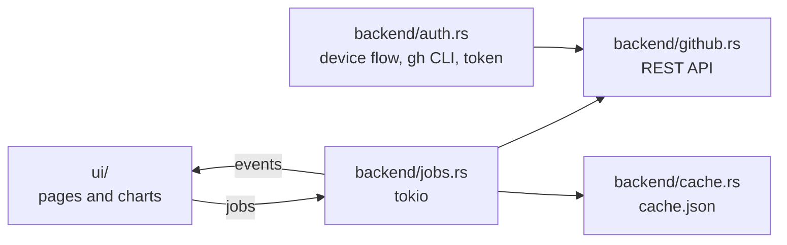

# Akulav Tracker: architecture

How the tracker is put together. What it does for users is in the [README](../README.md).

## Overview

One Rust program: an [egui](https://github.com/emilk/egui) window on top of a tokio backend. The window only
draws; the backend talks to GitHub and reports back with events.

## Backend (`src/backend/`)

| File | Role |
|---|---|
| `auth.rs` | Signing in: the GitHub OAuth device flow (no password touches the app), a token from the GitHub CLI, or a personal access token. The token is kept in the OS keychain on Windows / macOS and in a `0600` file on Linux |
| `github.rs` | The REST API: the signed-in user, their repositories, per-repository statistics |
| `jobs.rs` | Background work on the tokio runtime; every result goes to the UI as an `Event` |
| `cache.rs` | The last sync on disk (`cache.json`), so the app opens instantly and spares the rate limit |
| `stats.rs` | Derived numbers: freshness, totals across repositories, formatting |
| `net.rs` | A shared HTTP client, GETs with retries, streamed downloads |
| `settings.rs` | `settings.json` in the data folder |
| `demo.rs` | `--demo`: made-up repositories for trying the app without signing in |
| `update.rs` | Update check against the app's releases (one file per OS plus `SHA256SUMS.txt`) |
| `install/` | Inno Setup on Windows (`installer/akulav-tracker.iss`); self-install on Linux / macOS |

The app only talks to `api.github.com` and `github.com` (sign-in, releases).

## Window (`src/ui/`)

| File | Role |
|---|---|
| `app.rs` | State, event handling, title bar, sidebar, navigation, dialogs |
| `login.rs` | The sign-in screen (device flow, GitHub CLI token, personal access token) |
| `overview.rs` | Totals, activity over the year, languages, what needs attention |
| `repos.rs` | The searchable, filterable, sortable list (↑ / ↓ to move, Enter to open) |
| `detail.rs` | One repository: key numbers, code evolution, activity, languages, commits |
| `maintenance.rs` | The maintenance radar: how long since each repository's last commit |
| `settings_page.rs` | Account, updates, sync, install and about |
| `charts.rs` | Hand-painted charts (sparkline, area, heatmap, stacked bar, donut, code frequency, timeline) |
| `derive.rs` | Per-repository numbers computed once per frame for the pages |
| `theme.rs`, `widgets.rs` | The look shared with Akulav's other apps, with a commit-green accent |

## Sync

1. On start the cached sync (`cache.json`) is shown at once.
2. A sync job lists the user's repositories, then fetches statistics per repository. GitHub computes some
   statistics lazily (it answers `202 Accepted` first); those are asked again shortly after.
3. Results reach the UI as events from the job, and the finished sync replaces the cache.

## Releases

A release carries `AkulavTracker-setup.exe` (Windows), a self-installing program for Linux x64 and macOS (Apple
Silicon), and `SHA256SUMS.txt`. The same file installs and updates.
